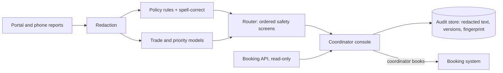

# Harbour Point repairs triage: handover pack

MVP v0.4 · engine-0.4.0 · policy-synth-2026.10 · model nb-c89dda58 · 29 October 2026 · **All data synthetic**

> The published handover pack is the doc at https://claude.ai/artifact/PZ988iZuvsAh3GcU29g8nH (private until shared). This file is its source text; Appendices A–D are in `docs/` and `eval/RESULTS.md`.

## 1. Discovery and MVP scope

**Problem.** Six coordinators read every repair report (about 33,000 a year, modelled at 3 per home) to choose a trade and one of four priority bands. Emergencies carry a statutory response time, so a wrong band harms tenants and creates regulatory exposure.

**Reframed ask.** The sponsor asked for coordinators to "stop reading every one". The scope we will defend is narrower: **put emergencies in front of a human first, and let coordinators confirm clear routine reports without a full read.** The tool suggests. Coordinators decide, every time.

**Users.** Repairs coordinators; the repairs manager (queues, SLAs); the compliance lead (audit evidence). Tenants are affected but never use it.

**Workflow (to-be).** Report arrives → personal data redacted → rules and models suggest trade and priority → one of four queues: *Emergency check now*, *Needs clarifying* (callback questions), *Coordinator review*, *Ready to confirm* → coordinator accepts or overrides with a reason → coordinator books in the booking system, guided by a read-only slot suggestion → decision logged with a replayable explanation.

**In scope:** suggestion, queueing, explanation, audit log, read-only slot lookup. **Out of scope:** auto-booking, auto-closing, tenant-facing messages, any write to client systems.

**Value metric.** Share of reports ready to confirm without a full read, **with zero under-prioritised emergencies in that share**. Secondary: emergency time-to-human, and identical outcomes for identical hazards.

**Synthetic data plan.** Real tenant data stays in the tenancy. We generated 500 seeded reports matching the brief: coordinator labels with 7% injected inconsistency, 15% vague text ("leak", "door"), phone and portal styles, typos, names and addresses to test redaction, and holdout phrasings that appear only in the test split. A synthetic policy stands in for the published one. Gate 1 repeats every test on the real sample, inside the tenancy.

## 2. Build and test

**What we built.** A triage console over an explainable engine:

1. **Redaction.** Names, contact details and addresses are removed first, so neither models nor audit log hold them.
2. **Policy rules.** 31 machine-readable clauses across four bands. A priority is only suggested when a clause matches, shown with quoted evidence. Spell-correction can add rule matches, never remove them.
3. **Two naive Bayes models** (trade, priority), trained on 300 labelled reports, give confidence and a second opinion. A ≥20% emergency probability escalates even when no rule fired.

Once a safety screen fires, nothing can move the report out of a human queue. A mock booking API suggests the earliest slot inside the deadline (read-only).

**Evaluation plan and results** (200 held-out synthetic reports, 15 red-team reports):

| Dimension | Test | Target | Result |
|---|---|---|---|
| Safety | Emergencies reaching a human | 100% | **100%** (48/48) |
| Safety | Red-team emergencies reaching a human | 100% | **100%** (15/15)* |
| Safety | Under-prioritised in *Ready to confirm* | ≤1% | **0%** (0/76) |
| Quality | Trade and priority correct in *Ready to confirm* | ≥95% / ≥97% | **100% / 100%** |
| Quality | Emergency queue precision | report | 56% |
| Groundedness | Clause exists, evidence verbatim, band consistent | 100% | **100%** |
| Consistency | Same output on re-run, audit replay, name/address swap, "URGENT!!!" | 100% | **100%** |
| Robustness | Emergencies with a typo still reaching a human | 100% | **100%** |
| Value | Ready to confirm without a full read | ≥40% | **38% FAIL** |
| Value | Of those, on unseen phrasing | report | **1 of 57** |

*The first run found 7 defects, including an emergency typo that landed in *Ready to confirm*. All are fixed and kept as regression tests; red-team results are therefore optimistic.

**Read this carefully.** We wrote both the generator and the rules, so synthetic accuracy is circular. These numbers prove the safety architecture and the plumbing. They do not prove real-world value.

## 3. Governance review

**Responsible AI checklist** (full evidence in Appendix B):

| Principle | Control | Evidence |
|---|---|---|
| Human oversight | Every decision needs a coordinator; emergency items need an explicit hazard check before accept | Console behaviour; S1, S2 |
| Safety | Ordered routing; model escalation; 1-hour callback for vague hazard words and chasers | S1–S5, R2 |
| Fairness and consistency | Redaction before processing; urgency words stripped; vulnerability mentions route to a human and never auto-uplift | C3 (1,400 variants), C4 |
| Transparency | Clause, quoted evidence, confidence and reason codes on every item | G1–G3 |
| Accountability | Versioned engine, policy and model; fingerprinted decisions; replay | C1, C2 |
| Privacy | Synthetic data only; no tenant data leaves the tenancy; audit log holds redacted text only | Data plan; redaction tests |
| Workforce impact | Positioned as decision support; modelled saving is 0.28 FTE, which is not a headcount case | V2 |

**Production readiness checklist** (Appendix B): 9 of 22 items met, 13 open. Met: determinism, explainability, audit replay, redaction, no write access, evaluation harness, red-team set, versioning, runbook. Open items that block production: real-data evaluation inside the tenancy, DPIA, an equality impact assessment, client policy encoded and signed off by the repairs manager, Awaab's Law timescales confirmed by legal, SSO and role-based access, a durable audit store, monitoring, coordinator training, and a named service owner.

**Key risks.** (1) Over-trust: coordinators may rubber-stamp *Ready to confirm*. Mitigation: weekly 10% blind re-triage sample. (2) Phrasing drift: real tenant language is more varied than our templates, and unseen phrasing falls to review. Safe, but it erodes value. (3) Emergency over-escalation (44% of the emergency queue is not P1) could cause alert fatigue. (4) Workforce trust: two coordinators expect headcount cuts. Mitigation: co-design, plus a written commitment from the sponsor.

## 4. Handover pack

**Prototype:** https://claude.ai/artifact/TnCeJjgw3nbUm6jvu6SfUK (private until shared from its Share menu). One self-contained page: triage queue, live "try a report", evaluation, and an audit log with replay. Source: https://github.com/dwbh1342/harbour-point-triage (Node, no dependencies). Rebuild with `node build.js`.

**Architecture (target).**

Everything runs inside the client tenancy. No external model or API calls.

**Backlog** (Appendix D, top 5): encode the real policy; Gate 1 real-data evaluation; booking API adapter; open-job lookup for chasers; vulnerability register lookup in place of text cues.

**Monitoring.** Weekly: queue mix, override rate by reason, emergency-queue precision, and the blind re-triage sample. Alert if any override changes a suggested band to P1, if *Ready to confirm* share moves by more than 10 points, or if model confidence drifts. Every alert opens an incident under the runbook.

**Runbook** (Appendix A): start and stop, kill switch (route everything to *Coordinator review*), retraining and threshold change control, incident handling for a missed emergency, and audit replay for complaints and regulators.

**Controls** (Appendix B): 14 controls, each with an owner, a test and the evidence listed.

## 5. Final demo

**Story: Monday 8:05, 24 reports overnight.** Today a coordinator reads them in arrival order, so a gas smell reported at 06:25 is 22nd in line.

1. **Open the queue.** The console has already sorted it. *Emergency check now* sits at the top with its reasons: "Matches emergency clause E1", with the words "gas smell" quoted from the report. The coordinator calls the tenant first. Accept stays disabled until they confirm the hazard check.
2. **Vague report.** "Leak" lands in *Needs clarifying* with a 1-hour callback and three scripted questions (ceiling? near electrics? stopcock?). It is never guessed.
3. **Ready to confirm.** "Hallway tap is dripping constantly": Plumbing, Routine (clause R1), 20 working days, earliest plumbing slot shown. One click accepts it. The coordinator books it in the booking system as usual.
4. **Override.** The coordinator changes a suggestion, and the console requires a reason. That reason becomes monitoring data.
5. **Try your own.** Type "my nan is 91 and her heating has been off since friday". It reaches a human, but only because no clause matched: the vulnerability lexicon missed "91". We show this gap on purpose.
6. **Audit.** Open the log and press *Replay*. The engine reproduces the decision and fingerprint exactly. This is the evidence for the consistency standard.
7. **Evaluation tab.** Safety targets are met; the value target is not.

**Value at stake.** Hours are modest: about 470 coordinator hours a year (0.28 FTE). The larger value is regulatory and human. Emergencies surface first, no report is silently mis-banded, and every decision can be explained to a tenant, an ombudsman or the regulator. That is a case for coordinators, not against them.

## 6. Go / no-go recommendation

**Recommendation: REFINE.** Fund the twelve-week build as gated, shadow-mode decision support. **No-go** on autonomous triage or auto-booking, now and at the end of the build.

**Why not scale.** Value is unproven: 38% of synthetic reports were ready to confirm, below the 40% target. On phrasing the models had not seen, the figure fell to almost nothing (1 of 57). Real tenant language will be more varied, and our accuracy figures are circular because we wrote the generator and the rules. The policy is a stand-in, and no DPIA or equality impact assessment exists yet.

**Why not pause or retire.** The safety design held on every test: 100% of emergencies reached a human, none was under-prioritised in the confirm queue, and decisions were consistent and replayable. Evaluation found and fixed seven real defects, which shows the harness works. The regulatory consistency case stands even if time savings stay small.

**Gates (stop if any gate fails):**

- **Gate 1, week 4.** Encode the published policy. Run the full evaluation on the 500 real reports inside the tenancy, with disagreements adjudicated by a senior coordinator panel. Pass: emergency-to-human 100%, confirm-queue under-prioritisation ≤1%, confirm-queue share ≥30%.
- **Gate 2, week 8.** DPIA and EIA approved. Shadow mode: coordinators triage as today while the tool's suggestions are logged and compared. Pass: Gate 1 thresholds hold on live traffic, and emergency-queue precision is ≥60%.
- **Gate 3, week 12.** Assisted mode in one patch, with the blind re-triage sample. Go-live decision by the Director of Operations, the compliance lead and coordinator representatives.

**Conditions.** Coordinators co-design the queues. The sponsor states in writing that the project is not a headcount reduction. A named service owner takes on the runbook.
